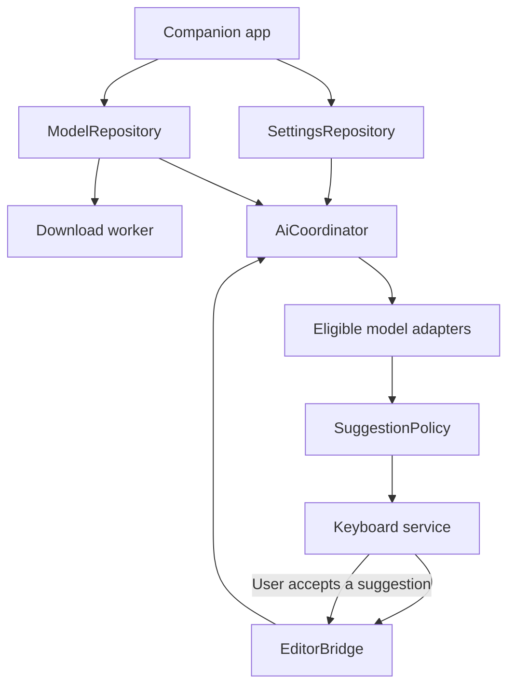
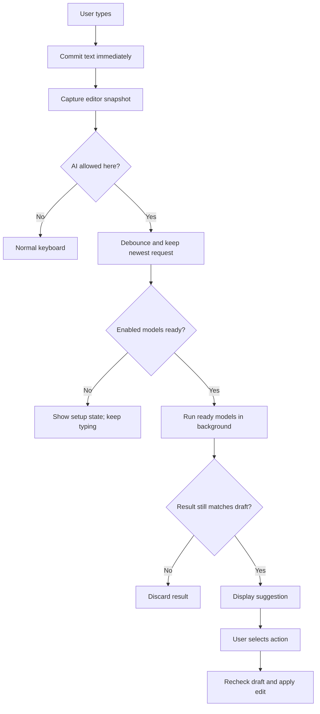

# AI Keyboard — implementation plan

Version 3 · 17 November 2026 · Android first · Java selected · Expanded model catalog

Status: implementation blueprint, not a built or benchmarked application. Java is the user-selected primary language. The approved UI is bundled in design/. “AI Keyboard” remains a working name.

## 1. Product and release boundary

Build one Android application containing a system keyboard and a companion settings app. People select this keyboard in Android and continue typing in their existing messaging apps. AI offers help using the active draft text the editor exposes.

The first complete version targets the following capabilities, implemented in testable increments:

- A dependable English QWERTY keyboard with shift/caps, punctuation, numbers, emoji input, backspace, selection replacement, enter actions, adjustable height, sound/haptics, and a keyboard switch control.
- An extensible local model catalog covering text, voice, images, and drawing. Emo, Redact, and Toxic are the first engineering milestone, not a product-wide limit. All 13 currently Android-supported Desert Ant models are candidates in the catalog below; each is released after its adapter and input workflow pass validation. Preserve vendor beta labels.
- A master AI switch, model downloads, model-specific settings, an editable test field, and app-specific AI preferences.
- The approved charcoal theme, subtle violet-to-navy AI panel, gradient AI icon, and a one-time activation animation.
- Basic local word suggestions/autocorrection from a separately licensed dictionary, staged after basic typing works. Desert Ant Emo is not a next-word prediction engine.

The visual familiarity of Gboard is the design reference. Reproducing its full swipe typing, multilingual prediction, GIF catalog, and dictation quality is a separate project. Do not copy Google branding or imply affiliation.

The complete scope includes voice, image, and drawing tools alongside live typing support. Build their input workflows in later milestones of this plan. While a capability is unfinished, hide its actions or label it Coming later; do not ship working-looking controls backed by placeholders. Rewriting, translation, and contextual reply generation require separate models beyond this task-model catalog. The adapter architecture must allow other model vendors later.

No account, custom backend, cloud inference, chat-history ingestion, notification listener, accessibility service, or screen scraping is needed for this release. A keyboard cannot automatically read an entire conversation or stop the host app’s own Send button.

## 2. Technology decisions

| Area | Decision | Reason |
|---|---|---|
| Language | Java — selected | Application, IME, controllers, repositories and tests use Java |
| OS baseline | Proposed minSdk 26; confirm in spike | Keeps the first device matrix manageable; vendor SDK documents API 24+ |
| Companion UI | Android Views/XML + Material Components, Fragments and View Binding | Java-native settings, onboarding, model library and test screens |
| Keyboard UI | Custom Android Views, owned by InputMethodService | Explicit handling of touch, key repeat, editor callbacks, and service lifecycle |
| Editor bridge | InputConnection | Read bounded available context and apply user-selected edits |
| Background work | Java ExecutorService and ScheduledExecutorService; callbacks/futures | Bounded inference queues, debounce and cancellation without blocking input |
| Settings | One Preferences DataStore through its RxJava 3 API | Java-friendly shared settings; subscriptions disposed with their owner |
| Downloads | Java ListenableWorker plus ModelRepository | Explicit downloads, progress, retry, network constraints and cancellation |
| AI | Desert Ant Android SDK behind Java-facing adapters | Reuse the published runtime; isolate Kotlin interoperability in one boundary |
| Dependency wiring | Small AppContainer | Keep the initial single-module project straightforward |
| Build | Gradle Groovy scripts + version catalog | Java-focused project with explicitly pinned dependencies |

Start with one Gradle app module, organized by responsibility. Keep the Activity, IME service, and workers in the default application process. Do not add android:process to the service. More than one DataStore instance for the same file in a process is invalid; obtain it from AppContainer.

The SDK docs currently list `ai.desertant:emo:4.3.0`, `ai.desertant:redact:4.3.0`, and `ai.desertant:toxic:4.3.0`. Treat these as the initial compatibility-spike candidates; verify actual dependency resolution and APIs before locking the build. Pin all other dependencies to compatible stable versions at that point. Compile/target SDK must be chosen against the release requirements current when publishing.

### 2.1 Java implementation contract

Java is selected. Do not reopen the language choice or default the application to Kotlin. Build the keyboard and companion app with Java classes, Android Views/XML, Material Components, View Binding and AndroidX ViewModel/LiveData where helpful. Reproduce the same approved appearance, including the purple-blue gradient and animation. Jetpack Compose and an embedded Python runtime are outside this implementation.

Use a small explicit AppContainer for dependencies. Use Java executor services for bounded inference and scheduled debounce; post view updates to the main thread. Use futures/callbacks that carry cancellation and exceptions. Never block a UI callback waiting for a result.

The model vendor's Android artifacts are Kotlin/JVM libraries, which can be used by a Java application. The compatibility spike must inspect the actual published Java-callable API. Prefer a Java-facing asynchronous API when available. If suspending Kotlin functions require an interop helper, confine the smallest necessary helper to `sdkbridge/DesertAntSuspendBridge.kt`; expose plain Java callbacks, a cancellable operation handle and Java data types. All application/domain/UI logic remains Java. Document why the helper is needed, and omit it if the published API already offers a suitable Java interface. Do not hand-roll fragile Continuation/cancellation code merely to remove one interop file. Kotlin runtime dependencies do not change the app's primary language.

Use the RxJava 3 DataStore builder from the official AndroidX package, with a single instance per settings file. SettingsRepository exposes immutable Java settings snapshots. It owns its service subscription; screen/ViewModel subscriptions are lifecycle-bound and disposed appropriately. Keep RxJava at the settings boundary unless there is a demonstrated need elsewhere.

Use ListenableWorker for model downloads. Its startWork callback is invoked on the main thread: immediately schedule background work and return the future. Propagate worker cancellation into the downloader/interop bridge; never perform synchronous file transfer or model loading inside startWork.

Select a Java source level and JDK compatible with the pinned Android Gradle Plugin during the spike. Use Android-compatible library APIs/desugaring as needed; do not assume every desktop JDK API is present on the minimum Android version.

Python remains optional for external evaluation or data-preparation scripts and is not a runtime dependency of the Android app.

### 2.2 Expanded model catalog

The SDK platform matrix currently lists 13 models with Android support. The placements and triggers below are our proposed product design, not a claim these integrations already exist.

| Model | Capability | Proposed placement and trigger |
|---|---|---|
| Emo | Emoji suggestions | Automatic short-draft suggestions |
| Redact | Personal-information detection and masking | Automatic draft notice; masking after acceptance |
| Toxic | Hate/abuse/threat triage | Optional draft notices; beta |
| Tongue | Text-language identification | Lightweight language hint for routing; never equate detection with translation |
| Gist | Topic tagging | Explicit Tag text action on a draft or imported snippet; uses its fixed topic taxonomy |
| Voz | Speech recognition | User-initiated microphone transcription or imported recording |
| Clear | Speech enhancement | Optional cleanup of captured/imported audio |
| Ear | Spoken-language identification | Optional audio-language hint before a compatible transcription workflow |
| Uhm | Filler-word detection | Flag spans in an audio preview; audio cutting is additional application logic |
| Who | Speaker labeling | Label turns in an imported multi-speaker recording; beta status where indicated |
| Eye | Image classification and quality analysis | Explicit image picker/import in the companion app; beta status where indicated |
| Moderator | NSFW image detection | Review a user-selected image before sharing |
| Shapes | Single-stroke shape recognition | A drawing panel that cleans up a stroke; not general handwriting-to-text |

Align, Clips and Title currently lack a published Android SDK entry. Schemer and Face are closed beta without shipping SDK integration. Keep these in a future/platform-limited section, not as functioning Android download toggles. Public weights alone do not establish production Android compatibility.

Keyboard model controls show only models relevant to the current input mode. The companion catalog groups models under Text, Voice, Images and Drawing and shows capability, vendor status, required input, availability and download state. Downloaded models are not all held in RAM or invoked on every keypress. Model selection alone never grants access to another app's recordings, attachments or chat history.

## 3. Application architecture

The keyboard commits text through EditorBridge. AiCoordinator receives snapshots asynchronously and asks only enabled, ready model adapters to analyze them. SuggestionPolicy turns their results into a small amount of useful UI. EditorBridge is the only component allowed to change the host editor.



The coordinator is deterministic application code. It does not call a large LLM to decide which small model to invoke. Typed events, eligibility rules, and model availability are enough.

Generalize `ModelAdapter` to typed input/output contracts, such as TextInput, AudioInput, ImageInput and StrokeInput. `ModelDescriptor` records supported triggers, required input, platform/ABI support, revision, settings schema, and measured resource class. Register adapters in code; downloadable catalog entries do not execute arbitrary downloaded application code. Adding a new runtime or adapter generally requires an app update.

Use separate activity events: DraftChanged, TextActionRequested, RecordingFinished, AudioImported, ImageSelected and StrokeFinished. Route only to enabled, ready adapters whose input requirements match. Keep voice/image processing out of the keystroke scheduler. Establish compatible audio sample rates, channels, timestamps, language coverage and stream/batch support before chaining audio models.

The global AI switch gates model invocation. Explicit companion actions offered while it is off first offer to enable AI. Each modality retains individual model choices. Pausing AI does not delete downloaded assets.

## 4. Installation and onboarding workflow

1. Install and open the companion app. Explain that AI uses the current input field and does not see the entire chat.
2. Open Android’s keyboard settings so the user can enable AI Keyboard. The app cannot enable itself silently.
3. Open the system input-method picker. Verify activation on return; let the user practice in a test field.
4. Offer the model catalog, with size, purpose, language coverage, and download state. AI starts off; no model downloads occur without a user action.
5. Download the chosen models. The first suggested setup is Emo and Redact; Toxic is optional and marked beta.
6. User enables AI. The keyboard toolbar shows a brief purple-to-blue sweep, then a steady active icon.
7. Opening a supported text field in WhatsApp, Telegram, Discord, or another app uses the keyboard normally. Actual compatibility is verified on devices, not assumed from the mockup.

## 5. Live typing workflow



### Event and snapshot design

Each snapshot carries `sessionId`, `generation`, `editorPackage`, `settingsRevision`, available text, selection range, composing range when known, and whether the context is partial. Session identifiers represent an input connection, not a person or contact. Never infer the recipient from a package name.

Listen to our own key actions plus editor lifecycle/selection updates. External paste, cursor moves, editor replacement, and app switches must invalidate prior results. Read only a bounded region using the InputConnection APIs available on that Android version. An editor can return less text than requested or no text; ordinary typing must still work.

Initial tunable timings: Emo after approximately 150 ms idle; Redact and Toxic after approximately 350–500 ms idle. These are starting design values, not measured guarantees. Do not run any model on the main thread, and do not use WorkManager for individual keystrokes.

Use latest-request-wins queues with limited concurrency. Cancel obsolete scheduled tasks/futures and notify the SDK bridge where supported, but do not assume thread interruption or cancellation immediately stops a native inference operation. Serialize calls to each model instance, wait for any non-cancellable call to finish safely, and suppress its output if the generation changed. Use one heavy inference slot initially; raise concurrency only after measurement.

### Eligibility

AI runs only when the master switch and that model’s switch are on, the host app is allowed, the field is supported, and model assets are ready. Disable assistance for password fields. Honor no-personalized-learning requests; as an additional product choice, suspend AI assistance for fields carrying that flag in the first release. The flag itself is a request about learning, not a general OS prohibition on inference. Never read draft contents into logs, crash attachments, or saved analytics.

Language coverage is model-specific. Start validation with English, then expand per model. Do not advertise Hindi/Hinglish PII protection merely because Emo supports Hindi; Redact’s documented language coverage differs. Tongue can provide a language hint when enabled, but short/mixed-script text needs uncertainty handling. A hint does not justify silently switching layouts or promising unsupported language coverage.

### Presenting and accepting suggestions

- Redact notices take visual priority, then Toxic notices, then Emo suggestions. A notice can be dismissed for the current unchanged draft so it does not reappear on every callback.
- Show at most one notice plus a compact set of emoji candidates. Keep keyboard height stable.
- Warnings appear in our own keyboard panel, not as overlays on another app’s message bubbles.
- Before applying any edit, re-read the relevant text/selection and check the session and generation. Reject a stale suggestion and recompute.
- Convert SDK offsets to Android editor offsets only after verifying their units. Test UTF-16 surrogate pairs, emoji sequences, combining marks, and multi-code-point graphemes.
- Redaction is user-selected. Use batch-edit operations where supported, preserve surrounding text, and provide a session-local Undo that also checks current text before restoring it.
- When context is partial, label the scope as the available draft portion. Never imply a complete scan or safe-to-send guarantee. If a reliable edit range cannot be established, show a preview the user can copy rather than changing the editor.

## 6. Model management and settings workflow

Separate these concepts in code:

| State dimension | Examples |
|---|---|
| Asset state | Not installed, queued, downloading, verifying, ready, failed, incompatible |
| User preference | Enabled or disabled |
| Runtime state | Unloaded, loading, loaded, running, unloading, failed |

A downloaded model may be disabled and unloaded. A selected model is not active until its assets and runtime are ready.

### Download lifecycle

1. A Download action schedules unique work per model revision.
2. ModelRepository supplies the pinned model manifest and app-private storage directory.
3. The worker downloads through the SDK’s supported interface, reports progress, and verifies the expected asset set. Confirm the exact SDK download/progress API and its Java interoperability in the compatibility spike.
4. Publish Ready only after every required file passes validation. Preserve a previous working revision until a new one is complete; use staging/atomic activation where the SDK permits.
5. Retry transient network failures with backoff. Surface low storage, corrupt assets, and unsupported device errors separately.
6. The keyboard loads only ready assets. Do not allow lazy first-use inference to trigger an unrequested download. Verify offline/preinstalled operation and network behavior in the spike; if necessary adapt or patch the downloader boundary before release.
7. Disabling a model removes its suggestions and unloads its runtime after in-flight work is safe to finish; files remain. Deleting a model disables it and removes only its owned files after releasing resources.

The SDK documents automatic caching and revision pinning. Our repository adds product-visible state and prevents that default download behavior from surprising someone while typing. Disk size is not peak RAM usage; profile each model on target hardware.

WorkManager’s UNMETERED constraint does not mean literally Wi-Fi. Prefer the label “Unmetered networks only.” If the exact “Wi-Fi only” setting from the concept is retained, add transport checks and stop/retry when transport changes.

### Settings propagation

Both keyboard switches and companion screens write to the same SettingsRepository. Its RxJava settings stream delivers immutable snapshots to the UI and coordinator. Every relevant change increments a revision so an old inference result cannot appear under new settings. Turning master AI off clears suggestions and cancels pending inference immediately; preserve individual choices automatically. Remove the redundant “Keep model choices when paused” preference from the production UI.

| Model | User settings in first release |
|---|---|
| Emo | Enabled, number of suggestions, skin-tone preference |
| Redact | Enabled, warn-only or offer-masking behavior, categories, advanced confidence floor |
| Toxic | Enabled, hateful/abusive/threat categories, calibrated sensitivity presets, beta label |

Additional model settings are defined during each adapter spike: language-hint behavior for Tongue/Ear, topic-display options for Gist, supported transcription and audio-preview options, image-review actions, and stroke preview controls. Distinguish application-level behavior from actual model parameters. Do not invent controls such as a cleanup-strength slider unless the verified API supports them.

Bundled assets need a different catalog state from downloadable assets. For example, the SDK documents Tongue as packaged with its library; show Included rather than a fake download button, and do not promise that deleting it removes bytes bundled in the APK.

Map model capabilities into a typed settings definition so the common detail screen can render them. Do not expose arbitrary parameters the SDK does not support. Validate the Java-facing SDK mapping for Redact labels/options and Toxic thresholds in the spike. A confidence setting must not pretend to control deterministic pattern matches that are handled separately by the SDK.

“Try it” runs the real adapter against explicitly entered sample text. A failing test model must show an error, not a fabricated sample success. Serialize test runs with keyboard inference if they share an instance.

App-specific preferences can be based on host package IDs observed during keyboard sessions, storing package IDs only. This avoids requesting a complete installed-app inventory just for the first settings page.

## 7. UI and motion specification

| Element | Implementation requirement |
|---|---|
| Normal keyboard | Charcoal, familiar rounded keys; no AI banner when off |
| AI toolbar control | Icon + explicit On/Off text; opens the AI panel |
| AI panel | Replaces the key area at similar height; master switch, model switches, Manage models, Back to keyboard |
| Panel background | Subtle gradient near `#392847` → `#272230` → `#181b25` |
| Active AI identity | Purple-to-blue sparkle, gradient border and master switch; icon colors near `#A970FF` → `#568DFF` |
| Activation animation | One 600 ms gradient sweep when user enables AI; then steady icon; no endless pulsing |
| Reduced motion | Skip sweep when system animations are disabled; immediate state change |
| Individual toggles | Pale blue for enabled, neutral gray for disabled |
| Inactive appearance | Gray AI icon; neutral border; no glow |
| Companion navigation | Keyboard, Models, Settings |
| Accessibility | TalkBack labels and focus, scalable text, clear state labels, accessible targets and contrast |

Use Java Android drawing/animation for the IME control and equivalent Views/XML components in the companion app. Share color and timing tokens. Do not embed web animation libraries or a WebView in the keyboard.

The approved mockup includes a microphone icon; enable it when a real user-initiated recording/transcription flow is implemented, with microphone permission requested at that point. Hide it in early internal builds before then. Image and audio tools operate on content explicitly provided by the user. Sharing generated images/audio into other apps uses supported Android sharing or rich-content mechanisms and host-specific checks; it is not interception of the host app's attachment UI.

## 8. Proposed file structure

This is a planned Java source layout, not a claim that these files already exist. Bracketed descriptions explain ownership and are not part of filenames. All packages below are under `com.example.aikeyboard` until the product name is finalized. The only possible handwritten Kotlin source is the narrowly scoped optional vendor-interop helper described above.

```text
ai-keyboard/
  README.md
  CLAUDE.md
  CLAUDE_START_PROMPT.md
  AI_Keyboard_Implementation_Plan.md
  PROGRESS.md
  build.gradle
  settings.gradle
  gradle.properties
  gradlew
  gradlew.bat
  gradle/wrapper/gradle-wrapper.jar
  gradle/wrapper/gradle-wrapper.properties
  gradle/libs.versions.toml
  docs/
    UI_SPEC.md
    BUILD_AND_TEST_CHECKLIST.md
    model-compatibility.md
    validation-report.md
  design/
    01_Keyboard_Approved.png
    02_Companion_App_Reference.png
  app/
    build.gradle
    proguard-rules.pro
    src/main/
      AndroidManifest.xml
      java/com/example/aikeyboard/
        KeyboardApplication.java
        AppContainer.java
        MainActivity.java
        ime/
          AiInputMethodService.java
          EditorBridge.java
          InputSession.java
          KeyboardController.java
          KeyboardLayout.java
          LocalWordSuggester.java
          view/
            KeyboardRootView.java
            KeyGridView.java
            SuggestionStripView.java
            AiPanelView.java
            AiToggleView.java
        ai/
          AiCoordinator.java
          DraftSnapshot.java
          ModelInput.java
          ModelResult.java
          ActivityEvent.java
          CapabilityRouter.java
          ModelAdapter.java
          Suggestion.java
          SuggestionPolicy.java
          InferenceScheduler.java
          adapters/
            EmoAdapter.java
            RedactAdapter.java
            ToxicAdapter.java
            TongueAdapter.java
            GistAdapter.java
            VozAdapter.java
            ClearAdapter.java
            EarAdapter.java
            UhmAdapter.java
            WhoAdapter.java
            EyeAdapter.java
            ModeratorAdapter.java
            ShapesAdapter.java
        media/
          AudioCaptureController.java
          AudioImportController.java
          AudioPipeline.java
          ImageImportController.java
          StrokeController.java
          ShareResultController.java
        models/
          ModelDescriptor.java
          ModelRegistry.java
          ModelRepository.java
          ModelRuntimePool.java
          ModelDownloadWorker.java
          ModelStorage.java
          ModelSettingDefinition.java
        sdkbridge/
          DesertAntClient.java
          CancellableOperation.java
          DesertAntSuspendBridge.kt  [only if required for SDK interop]
        data/
          AppSettings.java
          SettingsRepository.java
          PreferenceKeys.java
        core/
          InputEligibility.java
          TextRangeMapper.java
          DesignTokens.java
          AppExecutors.java
        ui/
          AppNavigator.java
          onboarding/SetupFragment.java
          onboarding/SetupViewModel.java
          keyboard/KeyboardPreviewFragment.java
          models/ModelLibraryFragment.java
          models/ModelDetailFragment.java
          models/ModelsViewModel.java
          tools/VoiceToolsFragment.java
          tools/ImageToolsFragment.java
          tools/DrawingFragment.java
          settings/SettingsFragment.java
          settings/AppPreferencesFragment.java
          settings/SettingsViewModel.java
          components/ModelRowViewHolder.java
          components/AiStatusView.java
          theme/ThemeController.java
      res/
        layout/activity_main.xml
        layout/fragment_setup.xml
        layout/fragment_keyboard_preview.xml
        layout/fragment_model_library.xml
        layout/fragment_model_detail.xml
        layout/fragment_settings.xml
        layout/fragment_app_preferences.xml
        layout/fragment_voice_tools.xml
        layout/fragment_image_tools.xml
        layout/fragment_drawing.xml
        layout/view_ai_panel.xml
        layout/item_model.xml
        values/colors.xml
        values/dimens.xml
        values/themes.xml
        xml/input_method.xml
        xml/backup_rules.xml
        xml/data_extraction_rules.xml
        values/strings.xml
        drawable/                 [original icons and static assets]
      assets/
        models/catalog.json       [metadata only, no model weights]
        dictionaries/             [licensed local lexical data]
    src/debug/
      java/com/example/aikeyboard/EditorTestActivity.java
    src/test/
      java/com/example/aikeyboard/
        AiCoordinatorTest.java
        SuggestionPolicyTest.java
        InputEligibilityTest.java
        TextRangeMapperTest.java
        ModelRepositoryTest.java
    src/androidTest/
      java/com/example/aikeyboard/
        EditorBridgeTest.java
        SettingsSyncTest.java
        OfflineInferenceTest.java
        KeyboardLatencyTest.java
        ModelSmokeTest.java
```

Key ownership:

- AiInputMethodService: Android lifecycle, editor connections, active keyboard view.
- EditorBridge: bounded reads and validated edits; the only host-text mutation boundary.
- AiCoordinator: event handling, eligibility, settings changes, generation checks.
- ModelAdapter and adapters: typed inference contract and SDK-specific conversion; no UI logic.
- InferenceScheduler: debounce and bounded work queues; never blocks the input path.
- ModelRepository: downloads, readiness, revisions, installation/deletion state.
- ModelRuntimePool: lazily creates, reuses, serializes access to, and closes native model instances.
- SettingsRepository: the single persisted source of preferences for both UIs.
- InputEligibility and TextRangeMapper: small pure components with focused tests.

All handwritten source files should begin with a short purpose comment. Document lifecycle and cancellation assumptions where they matter. Reuse classes for shared state and behavior, and use simple functions for stateless transformations. Avoid boilerplate interfaces for every class. Use valid syntax in config/data files; explain JSON files in adjacent documentation instead of adding invalid comments.

Downloaded model files live in app-private storage excluded from backup, not in the source repository. Models bundled by their SDK are tracked as included assets. Settings and catalog metadata persist; drafts, suggestions, and redaction maps remain session-local memory. Explicit media imports use scoped files/content URIs with a documented retention and cleanup policy; only user-requested exports persist as output files. Clear draft references when an editor session ends. Do not claim cryptographic erasure of JVM strings.

## 9. Implementation milestones and completion gates

| Milestone | Deliverable | Gate before continuing |
|---|---|---|
| 0. Compatibility spike | Tiny IME plus real SDK adapter experiment | Resolve the first three SDKs from Java; prove asynchronous Java-to-SDK calls and cancellation; establish download/offline behavior, option mappings, ABI support, memory and offsets on a physical device |
| 1. Reliable keyboard | AI-off keyboard and onboarding | Correct typing, selection, key repeat, emoji deletion, editor actions, input switching, and lifecycle recovery in a test host and target apps |
| 2. Companion and assets | Model library, persistent settings, download manager | Settings synchronize live; interrupted/corrupt downloads cannot be marked Ready; retry/delete work |
| 3. First vertical slice | Emo inference to visible suggestion to insertion | Real local inference, stale-result suppression, no typing stalls, works offline after download |
| 4. Privacy and tone assistance | Redact, Toxic, settings, previews and guarded edits | Category controls, false-positive handling, UTF-16 mapping, generation checks, and no auto-send behavior verified |
| 5. Expanded text catalog | Tongue and Gist with useful actions | Language uncertainty, fixed-taxonomy topic output and input scope verified |
| 6. Voice tools | Voz, Clear, Ear, Uhm and Who | Recording/import permission flows, adapter compatibility, cancellation, timestamps, preview and export verified |
| 7. Image and drawing tools | Eye, Moderator and Shapes | Explicit input selection, stroke handling, preview and host-compatible sharing verified |
| 8. Approved visual design | Full dark theme, subtle panel gradient, active icon and animation across all modes | Screens match approved composition; reduced motion and accessibility work; no nonfunctional controls |
| 9. Complete-version hardening | Signed test build and measured report | Device/app matrix, battery/memory, offline/network checks, storage failures, process death, license/attribution review completed for each released capability |
| Later | Other vendors, generative features and iOS | Separate model/runtime and platform feasibility established; no promise of unavailable Android SDKs |

Use these as outcome-based gates rather than promising a delivery date before the compatibility spike. Continue all work that does not depend on missing device access; record device-only checks as blocked, never passed. Section 11 is the starting task, not the completion boundary: the implementation target is milestones 0–9 and the full compatible catalog.

## 10. Verification and performance targets

These are proposed acceptance targets and must be measured on named devices:

- Key feedback fits within a frame where possible; aim for p95 local key-handling work below 8 ms on the baseline device. Record end-to-end editor latency separately because the host app contributes to it.
- Warm Emo suggestions aim to appear within 300 ms of the last key, including debounce. Redact/Toxic aim within 1 second of a pause. Tune against real memory, battery, and heat measurements.
- Normal typing remains available during model load, download failure, inference timeout, and AI-off transitions.
- Network-disabled testing confirms all installed model inference works offline. Capture network activity to ensure typing cannot trigger downloads or text upload.
- Rapid typing, paste, cursor movement, changing conversations, switching apps, and model disabling never apply results from an earlier snapshot.
- Test at least one constrained physical Android device and one current device; emulator coverage supplements these. Confirm the vendor-supported ABI set.
- App coverage: own debug editor host, WhatsApp, Telegram, Discord, browser text fields, and an ordinary notes app. Record OS and app versions used.
- Extended modes: microphone denial/revocation, interrupted recording, invalid audio formats, speaker/timestamp alignment, image import cancellation, image-share rejection, stroke ambiguity, and cancellation of heavy work while returning to typing.
- Explicit cases: password fields, no-learning flags, empty and very long drafts, unavailable context, mixed scripts, emoji families, combining accents, app process recreation, offline startup, low storage, and unavailable models.
- Evaluate model usefulness on a small consented/synthetic English draft set. Redact warnings are not proof all PII has been removed; Toxic is a review signal rather than a verdict.

Run Android Lint and Java unit tests for the coordinator, gating, mapping and repository. Use instrumentation for InputConnection edits, real SDK loading, settings propagation, and lifecycle behavior. Keep performance reporting separate from marketing benchmark claims.

## 11. First implementation task

Build a minimal English keyboard that can be selected in Android, type into a real app, download Emo explicitly, and insert a user-selected emoji from local inference. Use the approved AI-off and AI-on toolbar treatments. This single vertical slice proves the highest-risk boundaries before implementing the rest of the settings catalog.

## 12. Primary references

Checked 17 November 2026. SDK signatures and platform behavior should be verified again when dependencies are pinned.

- Android IME architecture: https://developer.android.com/develop/ui/views/touch-and-input/creating-input-method
- InputConnection contract: https://developer.android.com/reference/android/view/inputmethod/InputConnection
- EditorInfo flags: https://developer.android.com/reference/kotlin/android/view/inputmethod/EditorInfo
- DataStore: https://developer.android.com/topic/libraries/architecture/datastore/
- WorkManager constraints and retry: https://developer.android.com/develop/background-work/background-tasks/persistent/getting-started/define-work
- Desert Ant SDK, platform support and downloads: https://github.com/Desert-Ant-Labs/desert-ant-core
- Emo: https://desertant.com/docs/emo/
- Redact: https://desertant.com/docs/redact/
- Toxic: https://desertant.com/docs/toxic/
- Full model and SDK catalog: https://desertant.com/llms.txt
- Android Java support: https://developer.android.com/kotlin/first
- Java-friendly Preferences DataStore: https://developer.android.com/reference/androidx/datastore/preferences/rxjava3/RxPreferenceDataStoreBuilder
- Asynchronous Java workers: https://developer.android.com/develop/background-work/background-tasks/persistent/threading/listenableworker
- Kotlin-to-Java interoperability: https://kotlinlang.org/docs/java-to-kotlin-interop.html
- License entry point: https://license.desertant.com/latest — review the current source-available license and distribution obligations before release; do not assume unrestricted open-source licensing.

Approved keyboard reference: [Final softened violet panel](design/01_Keyboard_Approved.png).

Companion-app reference: [Model library and settings](design/02_Companion_App_Reference.png). Apply the keyboard’s final gradient identity consistently to its AI controls. The companion image is a visual reference from before the catalog expansion; implement all 13 supported model entries in Text, Voice, Images and Drawing groups, not only the models visible in that image. The latest written plan and docs/UI_SPEC.md take precedence where the image shows older behavior.
